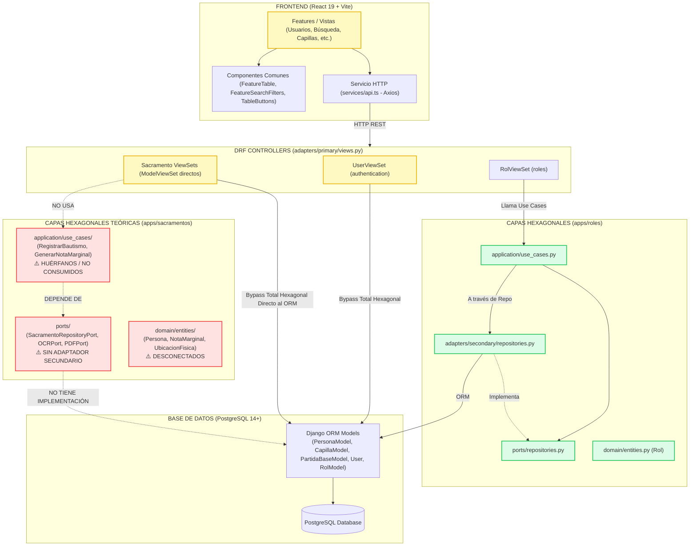
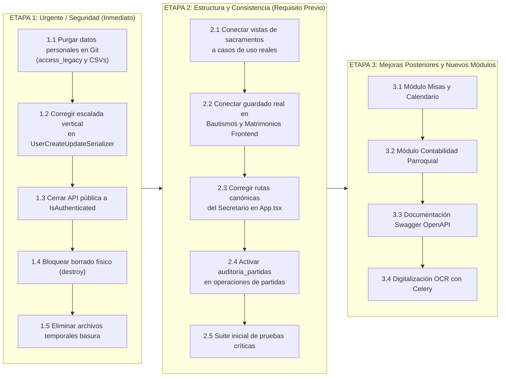

# Informe Técnico de Auditoría de Código y Arquitectura de Software — FidesSystem

**Fecha de Auditoría:** 10 de Noviembre de 2026  
**Auditor:** Arquitecto de Software Senior y Auditor de Código  
**Proyecto:** FidesSystem — Sistema de Gestión y Digitalización de Registros Sacramentales  
**Ámbito:** Repositorio Completo (Backend Django REST, Frontend React/Vite, Base de Datos, Configuración y Reglas de Agente)  
**Fase de Ejecución:** Fase 1 (Auditoría de Solo Lectura — Sin Modificación de Archivos)

---

## 1. Resumen Ejecutivo y Semáforo de Áreas

FidesSystem presenta un concepto de negocio eclesiástico sólido y un diseño visual atractivo con componentes reutilizables bien orientados. Sin embargo, **la base actual NO es suficientemente sólida para continuar construyendo los módulos restantes (misas/calendario, contabilidad, OCR)**. Existen vulnerabilidades críticas de seguridad (escalada vertical a SuperAdmin, exposición pública de partidas sin login, borrado físico habilitado y datos personales históricos reales de más de 22,000 feligreses versionados en Git). Arquitectónicamente, la capa de sacramentos es una "fachada hexagonal incompleta": las vistas DRF consumen directamente el ORM ignorando los casos de uso y puertos, mientras que en el frontend los módulos de Bautismos, Matrimonios y Capillas son simulaciones visuales que no persisten datos en el backend. Además, el proyecto cuenta con **0% de cobertura de pruebas automatizadas**.

### Semáforo por Área

| Área Evaluada | Estado | Justificación Resumida |
| :--- | :---: | :--- |
| **Seguridad y Protección de Datos** | 🔴 **ROJO** | Fuga de datos reales en Git (`.mdb` y `.csv`), escalada a SuperAdmin abierta, API sin autenticación por defecto (`IsAuthenticatedOrReadOnly`), secretos y hosts inseguros por defecto. |
| **Backend y Arquitectura Hexagonal** | 🔴 **ROJO** | `authentication` no tiene capas; `sacramentos` tiene puertos y casos de uso huérfanos que las vistas no consumen; inyección de dependencias hardcodeada. |
| **Frontend y Experiencia de Usuario** | 🟡 **AMARILLO** | Excelente base visual con Tailwind y componentes comunes, pero módulos clave (Bautismos, Matrimonios) son maquetas que no guardan datos; Secretario bloqueado erróneamente de sacramentos. |
| **Base de Datos y Modelado** | 🟡 **AMARILLO** | Buen modelo relacional central (PartidaBase + especializaciones), pero faltan índices de búsqueda crítica, hay borrado en cascada prohibido y claves auto-incrementables en roles. |
| **Integración Frontend-Backend** | 🟡 **AMARILLO** | Buscador de sacramentos y usuarios bien sincronizados, pero endpoints de creación de notas marginales incompatibles y funciones sueltas muertas en `api.ts`. |
| **Pruebas, Documentación y Operación** | 🔴 **ROJO** | Cero pruebas unitarias o de integración; archivos basura versionados (`temp_*.py`, `.tsx`); ausencia total de documentación Swagger/OpenAPI. |
| **Reglas y Skills de Agentes** | 🟡 **AMARILLO** | Desincronizadas con la realidad del código; contradicciones canónicas entre rutas y reglas; faltan reglas de seguridad, testing y contratos. |

---

## 2. Stack Tecnológico Real Descubierto

Tras inspeccionar `package.json`, `requirements.txt`, `settings.py`, `vite.config.ts`, `tsconfig*.json`, `eslint.config.js`, `build.sh`, `dev.bat`, `dev.ps1` y `run_backend.js`, se certifican los siguientes componentes tecnológicos reales:

### 2.1 Backend (Python / Django)
- **Lenguaje y Runtime:** Python 3.12 (detectado en `venv/` y `.pyc`).
- **Framework Web & API:** Django `5.2.17` (`requirements.txt:2` especifica `Django>=5.0,<6.0`), Django REST Framework `3.14.0+` (`requirements.txt:3`).
- **Mecanismo Real de Autenticación:** Tokens JWT mediante `djangorestframework-simplejwt` `5.3.1+` (`requirements.txt:4`) con `CaseInsensitiveModelBackend` (`settings.py:174-177`).
- **Base de Datos Real:** PostgreSQL (`psycopg2-binary>=2.9.9`, `dj-database-url>=2.1.0`). Soporta despliegue en Render vía `DATABASE_URL`.
- **Procesamiento Asíncrono Declarado:** Celery `5.3.6+` y Redis `5.0.1+` en dependencias (`requirements.txt:13-14`), **pero NO hay configuración de Celery (`celery.py`), tareas (`tasks.py`) ni workers operativos en el código actual**.
- **OCR y Generación de Documentos Declarados:** `pytesseract>=0.3.10`, `Pillow>=10.2.0`, `reportlab>=4.1.0` en dependencias (`requirements.txt:17,18,24`), **sin adaptadores secundarios implementados**.
- **Servidor y Archivos Estáticos:** Gunicorn `21.2.0+` y WhiteNoise `6.6.0+` con `CompressedManifestStaticFilesStorage`.

### 2.2 Frontend (React / TypeScript / Vite)
- **Librería UI:** React `19.2.8` y React DOM `19.2.8` (`frontend/package.json:18-19`).
- **Empaquetador y Bundler:** Vite `8.2.2` (`frontend/package.json:38`) con `@vitejs/plugin-react` `6.1.0` y `@tailwindcss/vite` `4.3.3`.
- **Lenguaje:** TypeScript `6.0.2` (`frontend/package.json:36`).
- **Enrutamiento:** React Router DOM `7.18.3` (`frontend/package.json:20`).
- **Cliente HTTP:** Axios `1.20.0` (`frontend/package.json:14`) con interceptores para inyección de cabecera `Authorization: Bearer <token>`.
- **Librerías de UI y Animación:** Tailwind CSS `4.3.3` (motor nativo sin `tailwind.config.js`), Framer Motion `13.1.1` (`frontend/package.json:15`), Lucide React `1.34.0`, QRCode React `4.2.0`.
- **Gestión de Estado:** `useState` + `useContext` nativos de React (`useAuth.tsx`, `useTheme.tsx`). **Nota:** `@tanstack/react-query` `5.102.6` está instalado en `dependencies` (`frontend/package.json:13`), pero **no se utiliza en ningún componente del proyecto**.

### 2.3 Herramientas de Calidad, Linting y Pruebas
- **Linter Frontend:** ESLint `10.9.0` con flat config (`frontend/eslint.config.js`) combinando `@eslint/js`, `typescript-eslint`, `eslint-plugin-react-hooks` y `eslint-plugin-react-refresh`.
- **Formateador de Código:** No hay configuración de Prettier ni de Black/Ruff en el proyecto.
- **Herramientas de Test:** **NINGUNA**. No hay Vitest, Jest ni Testing Library en frontend. En backend no hay pytest ni se usa el runner de Django (`manage.py test`). Cero archivos de test funcionales.
- **Documentación de API:** **NINGUNA**. No está instalado `drf-spectacular` ni `drf-yasg`. No existen rutas `/api/docs/` ni `/swagger/`.

---

## 3. Estado Real de la Arquitectura (Backend y Frontend)

### 3.1 Diagrama Mermaid de la Arquitectura Real vs Objetivo



---

## 4. Qué Está Bien Hecho y Debe Conservarse

No todo es deuda técnica. Hay cimientos sólidos sobre los que se debe construir:

1. **Patrón de Herencia de Partidas Base (`partidas_base`):**  
   La división arquitectónica entre una partida general (con libro, folio, partida, fecha, celebrante, registrado por) y extensiones especializadas 1-a-1 (`partidas_bautismo`, `partidas_matrimonio`) es canónicamente impecable y lista para escalar a comuniones, confirmaciones y defunciones (`backend/apps/sacramentos/adapters/secondary/models.py:123-186`).
2. **Restricción Física Inviolable de Libros:**  
   La constraint única `UniqueConstraint(fields=['libro', 'numero_folio', 'numero_partida'], name='unique_partida_fisica')` en `PartidaBaseModel` garantiza que jamás existan dos asientos sacramentales repetidos en el mismo folio físico (`backend/apps/sacramentos/adapters/secondary/models.py:146`).
3. **Módulo de Roles (`apps/roles`) como Boceto Hexagonal:**  
   Es la única app que implementó la secuencia limpia: Entidad (`domain/entities.py`), Contrato Puerto (`ports/repositories.py`), Casos de Uso (`application/use_cases.py`) y Repositorio Secundario que mapea entre entidad y modelo (`adapters/secondary/repositories.py`).
4. **Buscador Avanzado de Sacramentos (`BusquedaSacramentosFeature.tsx` y `BusquedaSacramentosViewSet`):**  
   La alineación de contrato entre el serializer del backend y la interfaz TypeScript (`SacramentoSearchResult`) funciona eficientemente, con debouncing, paginación en servidor y modal de certificado con código QR funcional.
5. **Ecosistema de Componentes UI Reutilizables:**  
   `FeatureTable`, `FeatureHeader`, `FeatureSearchFilters` y `TableButtons` (`frontend/src/components/common/`) establecen un estándar visual eclesiástico unificado de alta calidad con modo oscuro/claro persistente.
6. **Manejo Centralizado de Excepciones:**  
   `config/exceptions.py` intercepta errores de integridad de base de datos (`IntegrityError`) y errores 500 no controlados para garantizar respuestas JSON estructuradas, protegiendo al usuario de volcados de trazas HTML.

---

## 5. Análisis Detallado por Áreas

### A. Backend: Arquitectura Hexagonal

#### 1. Evaluación App por App

| App | Capas Presentes | Dominio Puro | Inyección de Dependencias | Mapeo ORM / Entidad | Veredicto |
| :--- | :--- | :---: | :---: | :---: | :---: |
| **`authentication`** | Ninguna (Tradicional Django MVC) | ❌ No | ❌ No | ❌ Directo ORM | **NO CUMPLE** |
| **`roles`** | `domain`, `ports`, `application`, `adapters` | ✔️ Sí | ⚠️ Parcial (hardcodeado en vista) | ✔️ Sí (`_to_entity`, `_to_model`) | **PARCIAL** |
| **`sacramentos`** | `domain`, `ports`, `application`, `adapters` | ✔️ Sí | ❌ Inexistente (vistas no llaman casos de uso) | ❌ Directo ORM | **NO CUMPLE (Fachada)** |

#### 2. Hallazgos Específicos
- **`apps/authentication` (No Cumple):** Es una app Django monolítica estándar (`models.py`, `serializers.py`, `views.py`). El modelo `User` hereda de `AbstractUser` acoplándose al motor ORM de Django con clave primaria numérica (`BigAutoField`). No existe separación de dominio para conceptos de usuario eclesiástico.
- **`apps/roles` (Cumple Parcial):** La lógica de negocio está bien aislada en `application/use_cases.py:5-53`. Sin embargo:
  1. `views.py:12` hace `self.repository = DjangoRolRepository()` dentro de `__init__`, violando la inyección externa de dependencias.
  2. `models.py` reside en la raíz de `apps/roles/` en lugar de `adapters/secondary/models.py`.
  3. `RolModel` utiliza `AutoField` (entero) en vez de UUID, y duplica parcialmente la tabla nativa `auth_group` de Django.
- **`apps/sacramentos` (Fachada Incompleta):**
  1. Las clases `RegistrarBautismoUseCase` y `GenerarNotaMarginalUseCase` en `application/use_cases/` nunca son invocadas por ningún controlador.
  2. Los puertos `SacramentoRepositoryPort`, `OCRProcessorPort` y `PDFGeneratorPort` no tienen implementación en `adapters/secondary/`. No existe ningún archivo `DjangoSacramentoRepository`.
  3. `adapters/primary/views.py` implementa 10 `ModelViewSet` de DRF estándar que consultan directamente `PersonaModel.objects`, `CapillaModel.objects`, etc., descartando por completo las capas de Dominio, Casos de Uso y Puertos.

---

### B. Base de Datos y Modelo de Datos

#### 1. Reconstrucción del Modelo de Datos Real (Mermaid erDiagram)

```mermaid
erDiagram
    PARROQUIA ||--o{ CAPILLA : "contiene (RESTRICT)"
    CAPILLA ||--o{ LIBRO_SACRAMENTAL : "custodia (RESTRICT)"
    CAPILLA ||--o{ USUARIO : "asigna_multicapilla (M2M)"
    
    PERSONA ||--o| USUARIO : "vincula_cuenta (SET_NULL)"
    PERSONA ||--o{ PARTIDA_BASE : "celebra_sacramento (RESTRICT)"
    PERSONA ||--o{ PARTIDA_BASE : "certifica_sacramento (SET_NULL)"
    PERSONA ||--o{ NOTA_MARGINAL : "autoriza_decreto (RESTRICT)"

    LIBRO_SACRAMENTAL ||--o{ PARTIDA_BASE : "registra_asientos (RESTRICT)"
    
    USUARIO ||--o{ PARTIDA_BASE : "digita_partida (RESTRICT)"
    USUARIO ||--o{ PARTIDA_BASE : "modifica_partida (SET_NULL)"
    USUARIO ||--o{ AUDITORIA_PARTIDA : "ejecuta_accion (RESTRICT)"
    
    PARTIDA_BASE ||--o| PARTIDA_BAUTISMO : "especializa_1a1 (CASCADE)"
    PARTIDA_BASE ||--o| PARTIDA_MATRIMONIO : "especializa_1a1 (CASCADE)"
    PARTIDA_BASE ||--o{ AUDITORIA_PARTIDA : "rastrea_cambios (CASCADE)"
    PARTIDA_BASE ||--o{ NOTA_MARGINAL : "genera_partida_origen (SET_NULL)"

    PARTIDA_BAUTISMO ||--o{ NOTA_MARGINAL : "anota_al_margen (RESTRICT)"
    PERSONA ||--o{ PARTIDA_BAUTISMO : "bautizado (RESTRICT)"
    PERSONA ||--o{ PARTIDA_BAUTISMO : "padre (SET_NULL)"
    PERSONA ||--o{ PARTIDA_BAUTISMO : "madre (SET_NULL)"
    PERSONA ||--o{ PARTIDA_BAUTISMO : "padrino (SET_NULL)"
    PERSONA ||--o{ PARTIDA_BAUTISMO : "madrina (SET_NULL)"

    PERSONA ||--o{ PARTIDA_MATRIMONIO : "novio (RESTRICT)"
    PERSONA ||--o{ PARTIDA_MATRIMONIO : "novia (RESTRICT)"
    PERSONA ||--o{ PARTIDA_MATRIMONIO : "padrino_mat (SET_NULL)"
    PERSONA ||--o{ PARTIDA_MATRIMONIO : "madrina_mat (SET_NULL)"
    PERSONA ||--o{ PARTIDA_MATRIMONIO : "testigo_1 (SET_NULL)"
    PERSONA ||--o{ PARTIDA_MATRIMONIO : "testigo_2 (SET_NULL)"

    PARROQUIA {
        UUID id PK
        string nombre
        string diocesis
        string estado
    }

    CAPILLA {
        UUID id PK
        UUID parroquia_id FK
        string nombre
        boolean es_sede_principal
        string coordenadas_gps
        string estado
    }

    PERSONA {
        UUID id PK
        string nombres
        string apellido_paterno
        string apellido_materno
        string ci
        date fecha_nacimiento
        string tipo_persona
        string legacy_ref
    }

    LIBRO_SACRAMENTAL {
        UUID id PK
        UUID capilla_id FK
        string tipo_sacramento
        string numero_libro
        string estado
    }

    PARTIDA_BASE {
        UUID id PK
        UUID libro_id FK
        string numero_folio
        string numero_partida
        date fecha_sacramento
        UUID sacerdote_celebrante_id FK
        string estado_partida
        string legacy_ref
    }

    PARTIDA_BAUTISMO {
        UUID partida_id PK_FK
        UUID bautizado_id FK
        boolean hijo_legitimo
    }

    PARTIDA_MATRIMONIO {
        UUID partida_id PK_FK
        UUID novio_id FK
        UUID novia_id FK
        string reg_civil_partida
    }

    NOTA_MARGINAL {
        UUID id PK
        UUID partida_bautismo_id FK
        string tipo_anotacion
        text descripcion
        date fecha_decreto
        UUID autorizado_por_id FK
    }

    AUDITORIA_PARTIDA {
        UUID id PK
        UUID partida_id FK
        UUID usuario_id FK
        string accion
        jsonb datos_anteriores
        jsonb datos_nuevos
    }

    USUARIO {
        bigint id PK
        string username
        string email
        boolean is_active
        boolean is_superuser
    }
```

#### 2. Normalización, Integridad y Brechas
- **Borrado en Cascada (`CASCADE`) Prohibido:**  
  `PartidaBautismoModel:155`, `PartidaMatrimonioModel:170` y `AuditoriaPartidaModel:211` definen `on_delete=models.CASCADE`. Aunque en las especializaciones responde al patrón de herencia de tablas delegadas de Django, en `AuditoriaPartidaModel` es un error grave: si se elimina una partida, **su pista de auditoría se destruye en cascada**.
- **Idoneidad para Módulos Futuros:**
  1. *Calendario y Misas:* El esquema SQL prevé `eventos_liturgicos` e `intenciones_misa`, pero los modelos Django aún no existen.
  2. *Contabilidad:* No hay ninguna tabla de ingresos, egresos ni cobro de derechos de estipendio o certificados en el backend (solo una tabla `comprobantes_pago` huérfana en el SQL plano).
  3. *Multi-Parroquia:* `CapillaModel` está vinculado a `ParroquiaModel`, lo cual es adecuado. Sin embargo, `User` se asocia a capillas y no a nivel parroquial, y las consultas de búsqueda asumen que solo hay una capilla con `es_sede_principal=True` (`migrate_access_to_fides.py:564`).

#### 3. Scripts de Migración desde Access (`backend/scripts/`)
- **Idempotencia:** Correcta. Utiliza `legacy_source` y `legacy_ref` con índices únicos en `PersonaModel` y `PartidaBaseModel` para evitar reinsertar registros duplicados.
- **Riesgo de Corrupción y Pérdida de Datos Canónicos:**
  1. *Pérdida de Apellidos:* La función `split_person_name` (`migrate_access_to_fides.py:157`) extrae el último token como apellido paterno y descarta el materno (`return " ".join(parts[:-1]), parts[-1], None`), truncando los apellidos maternos en nombres tradicionales hispanos ("JUAN PEREZ GOMEZ" -> Nombre: "JUAN PEREZ", Paterno: "GOMEZ", Materno: `None`).
  2. *Asignación Centralizada Forzada:* Línea 564 asigna la totalidad de los 22,237 bautismos históricos a la capilla principal única (`CapillaModel.objects.get(es_sede_principal=True)`), sin distinguir si pertenecían a capillas filiales.
  3. *Usuario Migrador Hardcodeado:* Depende de que exista el usuario exacto `SuperAdmin` (`migrate_access_to_fides.py:174`).

---

### C. Seguridad (Evaluación Prioritaria)

1. **Exposición de Datos Personales Sensibles en Git (Hallazgo Crítico SEC-01):**  
   El archivo de base de datos Access real `backend/access_legacy_workcopy.mdb` (31,256,576 bytes / 31.25 MB) y los 22 archivos CSV en `backend/legacy_exports/` (con más de 18 MB de datos personales de feligreses) **están rastreados y versionados en el árbol de Git** (`git ls-files`). Contienen nombres completos, fechas de bautismo, nombres de padres, notas de legitimidad y datos civiles de miles de ciudadanos bolivianos. **Debe ser purgado de inmediato del historial de Git.**
2. **Escalada Vertical de Privilegios a `SUPERADMIN` (Hallazgo Crítico SEC-02):**  
   En `backend/apps/authentication/views.py:9-10`, `UserViewSet` tiene como única protección `permission_classes = [IsAuthenticated]`.  
   En `backend/apps/authentication/serializers.py:188-192`:
   ```python
   if role in ['SUPERADMIN', 'ADMINISTRADOR']:
       user.is_staff = True
       if role == 'SUPERADMIN':
           user.is_superuser = True
   ```
   No existe ninguna comprobación que verifique el rol del usuario que realiza la petición (`request.user`). Un usuario con rol `FELIGRES` autenticado puede enviar una solicitud `POST /api/auth/users/` con `role: "SUPERADMIN"` y Django le otorgará `is_superuser = True` e `is_staff = True`.
3. **Lectura Pública Sin Autenticación de Todo el Archivo Sacramental (Hallazgo Crítico SEC-03 y SEC-04):**  
   Los controladores de personas, capillas, libros, partidas, bautismos, matrimonios, notas marginales y búsqueda sacramental tienen asignado `permission_classes = [IsAuthenticatedOrReadOnly]`.  
   En `BusquedaSacramentosViewSet` (`views.py:189-204`), la condición de jurisdicción horizontal dice:
   ```python
   if user.is_authenticated and not (user.is_superuser or ...):
       ...
   ```
   Si la petición proviene de un cliente **no autenticado**, la condición se evalúa como falsa y **no se aplica ningún filtro de jurisdicción**, devolviendo a cualquier visitante anónimo de internet la totalidad del archivo de personas y sacramentos.
4. **Habilitación de Borrado Físico Indiscriminado (Hallazgo Crítico SEC-05):**  
   Los `ModelViewSet` exponen de manera nativa la acción `destroy` (HTTP `DELETE`). Como no se ha sobrescrito `destroy()`, cualquier usuario autenticado puede disparar un `DELETE /api/sacramentos/personas/<uuid>/` o `/api/auth/users/<id>/` y ejecutar un `DELETE` físico en PostgreSQL, destruyendo información sacramental histórica sin posibilidad de recuperación.
5. **Debilidad en Configuración de Producción (`settings.py`):**
   - Fallback de `SECRET_KEY` hardcodeada a valor inseguro (`settings.py:20`).
   - `ALLOWED_HOSTS = ['*']` por defecto (`settings.py:25`).
   - `CORS_ALLOW_ALL_ORIGINS = True` por defecto (`settings.py:160`).
   - Falta de configuración de cookies HTTPS seguras (`CSRF_COOKIE_SECURE`, `SESSION_COOKIE_SECURE`).
6. **Manejo de Tokens JWT:**
   - La validez del Access Token es de 24 horas (`settings.py:168`), excesiva para un sistema con datos confidenciales.
   - El token se guarda en `localStorage` (`useAuth.tsx:54`), siendo vulnerable a ataques de Cross-Site Scripting (XSS).
   - El Refresh Token se desecha y nunca se utiliza.

---

### D. Frontend y Experiencia de Usuario

#### 1. ¿Aplica Arquitectura Hexagonal en Frontend? (Recomendación Técnica)
- **Estado Actual:** El frontend no aplica arquitectura hexagonal. Sigue una estructura orientada a características (`features/`) con llamadas directas a un servicio Axios (`services/api.ts`).
- **Dictamen del Arquitecto:** **NO se recomienda implementar Arquitectura Hexagonal estricta en el Frontend para FidesSystem.**
  - *Contra de Hexagonal en Frontend:* Requiere crear interfaces abstractas en TypeScript, adaptadores de renderizado, DTOs de vista y casos de uso en cliente para cada pantalla, lo que triplicaría los archivos sin aportar valor real en un proyecto de grado con un único desarrollador.
  - *Enfoque Recomendado (Clean Feature Architecture):* Mantener la separación de 4 capas: (1) **Dominio** (`domain/types.ts`), (2) **Servicios de Infraestructura** (`services/` modularizados por dominio), (3) **Hooks de Estado y Orquestación** (`hooks/`), y (4) **Componentes UI Presentacionales** (`features/` divididos en subcomponentes pequeños + `components/common/`).

#### 2. Funcionalidades Simuladas (Mocks Disfrazados de Código Real)
- En `BautismosFeature.tsx:52-80` y `MatrimoniosFeature.tsx:49-76`, la función `handleSubmit` ejecuta `triggerAlert('creado', 'PARTIDA REGISTRADA')`, limpia el formulario y cierra el modal, **sin hacer ninguna llamada HTTP a la API**. El registro jamás se guarda en la base de datos.
- En `CapillasFeature.tsx:30-34`, el cambio de estado (activo/inactivo) solo muestra un toast animado y no envía ningún `PATCH` al servidor.
- `AuditoriaFeature.tsx`, `ComprobantesFeature.tsx`, `EventosFeature.tsx` y `OCRFeature.tsx` tienen datos estáticos codificados en memoria ("hardcoded") y cero integración con el backend.

#### 3. Tamaño y Mantenibilidad de Componentes
- `BusquedaSacramentosFeature.tsx` tiene **936 líneas** y `UsuariosFeature.tsx` tiene **611 líneas**. En ambos archivos conviven el estado global de la página, modales flotantes de 200 líneas, renderizado de tablas y lógica de debounce. Deben modularizarse extrayendo los modales a subcomponentes.

---

### E. Integración Frontend-Backend

#### 1. Matriz de Endpoints Reales vs Consumo en Frontend

| Método | Endpoint Backend | Permiso Real Backend | Consumo Frontend (Archivo:Línea) | Estado de Contrato |
| :--- | :--- | :--- | :--- | :--- |
| `POST` | `/api/auth/token/` | Público | `frontend/src/services/api.ts:78` | ✔️ Sincronizado |
| `POST` | `/api/auth/token/refresh/` | Público | ❌ No consumido en frontend | ⚠️ Huérfano |
| `GET` | `/api/auth/users/me/` | `IsAuthenticated` | `frontend/src/services/api.ts:82` | ✔️ Sincronizado |
| `GET/POST`| `/api/auth/users/` | `IsAuthenticated` | `frontend/src/services/api.ts:153,157` | ⚠️ Faltan validaciones de rol |
| `POST` | `/api/auth/users/{id}/toggle_active/` | `IsAuthenticated` | `frontend/src/services/api.ts:165` | ✔️ Sincronizado |
| `GET` | `/api/roles/` | `IsAuthenticatedOrReadOnly` | `frontend/src/services/api.ts:175` | ⚠️ Vista pública |
| `GET` | `/api/roles/permisos/` | `IsAuthenticatedOrReadOnly` | `frontend/src/services/api.ts:179` | ✔️ Sincronizado |
| `GET/POST`| `/api/sacramentos/parroquias/`| `IsAuthenticatedOrReadOnly` | `frontend/src/services/api.ts:54,88` | ⚠️ Funciones duplicadas en api.ts |
| `GET/POST`| `/api/sacramentos/capillas/` | `IsAuthenticatedOrReadOnly` | `frontend/src/services/api.ts:66,92` | ⚠️ Ignora `?all=true` |
| `GET/POST`| `/api/sacramentos/personas/` | `IsAuthenticatedOrReadOnly` | `frontend/src/services/api.ts:99,111` | ✔️ Sincronizado |
| `GET/POST`| `/api/sacramentos/libros/` | `IsAuthenticatedOrReadOnly` | `frontend/src/services/api.ts:117` | ⚠️ No usado en features |
| `GET/POST`| `/api/sacramentos/bautismos/`| `IsAuthenticatedOrReadOnly` | `frontend/src/services/api.ts:126` | ❌ Frontend no envía POST real |
| `GET/POST`| `/api/sacramentos/matrimonios/`| `IsAuthenticatedOrReadOnly` | `frontend/src/services/api.ts:130`| ❌ Frontend no envía POST real |
| `GET/POST`| `/api/sacramentos/notas-marginales/`| `IsAuthenticatedOrReadOnly`| `frontend/src/services/api.ts:136,146`| ❌ Incompatible: envía nombre, backend pide UUID |
| `GET` | `/api/sacramentos/busqueda-sacramentos/`| `IsAuthenticatedOrReadOnly`| `frontend/src/services/api.ts:209`| ✔️ Sincronizado |

---

### F. Consistencia de Módulos (Matriz de Patrón)

| Módulo | Capas Backend | Modelos ORM | Soft Delete Real | Frontend Conectado | Componentes Comunes Usados |
| :--- | :--- | :--- | :---: | :---: | :---: |
| **Usuarios** | Tradicional MVC | `apps/authentication/models.py` | ✔️ `is_active` | ✔️ Sí | ✔️ Sí (Header, Table, Filters, Buttons) |
| **Roles** | Hexagonal Completo | `apps/roles/models.py` (en raíz) | ❌ No tiene | ✔️ Sí | ✔️ Sí (Header, Table, Filters, Buttons) |
| **Sacramentos (Búsqueda)**| Fachada Hexagonal | `apps/sacramentos/adapters/secondary/` | ✔️ `estado_partida` | ✔️ Sí | ⚠️ Tabla personalizada por complejidad |
| **Bautismos / Matrimonios**| Fachada Hexagonal | `apps/sacramentos/adapters/secondary/` | ❌ Simulado en UI | ❌ No (solo GET) | ✔️ Sí (Table, Header) |
| **Capillas** | Fachada Hexagonal | `apps/sacramentos/adapters/secondary/` | ❌ Simulado en UI | ⚠️ Solo GET | ❌ No usa Table ni Buttons comunes |

#### Módulo de Referencia Recomendado (Plantilla)
- **Backend:** `apps/roles` debe servir como plantilla para la Arquitectura Hexagonal, corrigiendo antes: mover `models.py` a `adapters/secondary/models.py`, cambiar `id` a UUID y desacoplar la instanciación directa del repositorio en la vista.
- **Frontend:** `UsuariosFeature.tsx` es el módulo con la mejor integración funcional y visual según los estándares de `ui-components.md`, pero debe servir de molde tras separar su modal de creación en `components/UserFormModal.tsx`.

---

### G. Pruebas, Documentación y Operación

#### 1. Estado de Pruebas
- Backend: Cero pruebas. La carpeta `backend/apps/sacramentos/tests/` solo contenía residuos compilados de Python (`__pycache__/test_capillas.cpython-312.pyc`), pero ningún archivo `.py` de prueba.
- Frontend: Cero pruebas.
- **Pruebas Críticas Prioritarias Requeridas:**
  1. *Test de Autorización Vertical:* Garantizar que un `SECRETARIO` o `PARROCO` reciba HTTP 403 al intentar registrar un `SUPERADMIN`.
  2. *Test de Consulta Anónima:* Verificar que peticiones anónimas a `/api/sacramentos/busqueda-sacramentos/` y `/personas/` sean rechazadas con HTTP 401.
  3. *Test de Unicidad de Libro Sacramental:* Comprobar que no se puedan registrar dos partidas con el mismo libro, folio y partida en una misma capilla.

#### 2. Clasificación de Archivos Temporales y Basura Versionados

| Archivo Encontrado | Tamaño | Estado Git | Clasificación | Justificación |
| :--- | :---: | :---: | :---: | :--- |
| `backend/temp_serializers.py` | 18.8 KB | Versionado | **ELIMINAR** | Archivo temporal en codificación UTF-16LE, residuo de desarrollo previo. |
| `backend/seed_data_temp.txt` | 13.5 KB | Versionado | **ELIMINAR** | Copia de texto plano duplicada del comando `seed_data.py`. |
| `frontend/Plaintext` | 2.1 KB | Versionado | **ELIMINAR / MOVER** | Documento de requerimientos sin extensión; su contenido ya reside en `.agents/rules/`. |
| `frontend/temp_user.tsx` | 17.5 KB | Versionado | **ELIMINAR** | Boceto temporal del formulario de usuario en la raíz de frontend. |
| `frontend/temp_usuarios_feature.tsx` | 17.2 KB | Versionado | **ELIMINAR** | Boceto temporal duplicado de `UsuariosFeature.tsx`. |
| `backend/build.sh` | 441 B | Versionado | **ELIMINAR** | Duplicado redundante del archivo raíz `build.sh`. Conservar únicamente `build.sh` en la raíz. |
| `frontend/src/features/ParroquiasFeature/` | 0 B | No versionado (vacío) | **ELIMINAR** | Carpeta vacía sin componentes ni archivos. |

---

### H. Reglas y Skills del Agente (`.agents/`)

1. **Desalineación de Reglas con el Código:**
   - `backend-architecture.md` exige que los casos de uso gobiernen toda la lógica y prohíbe pasar modelos nativos a las vistas. En el código real, `sacramentos` utiliza `ModelViewSet` directos que saltan los casos de uso.
   - `database-rules.md:21-28` prohíbe taxativamente `models.CASCADE`, pero la herencia multi-tabla de Django para `PartidaBautismoModel` y `PartidaMatrimonioModel` lo requiere técnicamente en su `OneToOneField(primary_key=True)`.
   - `role-permissions.md:29-30` define al Secretario como digitador de sacramentos y personas, pero el enrutamiento de `frontend/src/App.tsx:36-44` le prohíbe acceder a Bautismos, Matrimonios y Notas Marginales.
2. **Reglas Faltantes Recomendadas:**
   - Regla de Contratos de API (formato de errores estándar, nomenclatura de campos y paginación).
   - Regla de Protección de Datos Personales y Auditoría Canónica (prohibición de versionar datos reales y obligación de logging de accesos).
   - Regla de "Definición de Terminado" (Definition of Done) para features (prohibición de dejar botones mock con alertas simuladas).
3. **Skills Faltantes:**
   - `crear-caso-de-uso`: Scaffolding que cree entidad, puerto, caso de uso y su correspondiente unit test con mocks.
   - `crear-test-backend`: Generador automático de tests unitarios y de integración para endpoints DRF.

---

## 6. Veredicto Explícito para Avanzar

> ### 🛑 VEREDICTO FORMAL: NO SE PUEDE AVANZAR AÚN
> **La base actual NO es suficientemente sólida para seguir construyendo los módulos restantes (misas/calendario, contabilidad, OCR).**  
> 
> Si se procede a implementar Contabilidad y Misas sobre esta infraestructura:
> 1. El módulo de contabilidad heredará la falta de control de borrado físico (`DELETE`), permitiendo borrar transacciones financieras de las capillas directamente desde la API sin auditoría.
> 2. Los datos financieros y de intenciones litúrgicas quedarán expuestos a lectura pública por la directiva permisiva `IsAuthenticatedOrReadOnly`.
> 3. Se continuará acumulando código mock simulado en el frontend sin integración real con la base de datos.
> 
> **Condición de Avance:** Se debe ejecutar la **Etapa 1 (Urgente / Seguridad)** y la **Etapa 2 (Estructura y Consistencia)** antes de iniciar el desarrollo de Misas, Calendario, Contabilidad u OCR.

---

## 7. Plan Priorizado de Remediación en 3 Etapas



### Detalle de Tareas del Plan

#### Etapa 1: Seguridad y Bloqueo de Brechas (Urgente — Inmediato)
1. **Paso 1.1 — Purgar Datos Sensibles de Git:** Remover `access_legacy_workcopy.mdb` y `backend/legacy_exports/` del índice de Git, agregarlos a `.gitignore` y limpiar el historial de commits. *(Esfuerzo: M | Dependencia: Ninguna)*
2. **Paso 1.2 — Corregir Escalada de Privilegios:** Validar en `UserCreateUpdateSerializer.validate()` que un usuario no pueda asignar un rol igual o superior al suyo. Denegar creación de SuperAdmin salvo por superusuarios. *(Esfuerzo: S | Dependencia: Ninguna)*
3. **Paso 1.3 — Cerrar Exposición de API:** Cambiar `DEFAULT_PERMISSION_CLASSES` en `settings.py` y en todos los ViewSets sacramentales a `IsAuthenticated`. *(Esfuerzo: S | Dependencia: Ninguna)*
4. **Paso 1.4 — Bloquear Borrado Físico:** Sobrescribir `destroy()` en todos los `ModelViewSet` del backend para retornar HTTP 405 Method Not Allowed o redirigir a cambio de estado (soft delete). *(Esfuerzo: S | Dependencia: Ninguna)*
5. **Paso 1.5 — Configurar Seguridad de Producción:** Eliminar la `SECRET_KEY` fija por defecto, restringir `ALLOWED_HOSTS` y limitar orígenes de CORS. *(Esfuerzo: S | Dependencia: Ninguna)*
6. **Paso 1.6 — Limpieza de Archivos Basura:** Eliminar `temp_serializers.py`, `seed_data_temp.txt`, `temp_user.tsx`, `temp_usuarios_feature.tsx`, `Plaintext` y `backend/build.sh`. *(Esfuerzo: S | Dependencia: Ninguna)*

#### Etapa 2: Estructura, Consistencia y Conexión Real (Requisito para Avanzar)
1. **Paso 2.1 — Conectar Vistas de Sacramentos con Casos de Uso:** Implementar `DjangoSacramentoRepository` en `adapters/secondary/repositories.py` e inyectarlo en los controladores primarios para que `RegistrarBautismoUseCase` procese las altas reales. *(Esfuerzo: M | Dependencia: 1.3)*
2. **Paso 2.2 — Conectar Formularios de Bautismo y Matrimonio en Frontend:** Reemplazar el código mock en `BautismosFeature.tsx` y `MatrimoniosFeature.tsx` con llamadas reales a `apiService.createBautismo` y `apiService.anularBautismo`. *(Esfuerzo: M | Dependencia: 2.1)*
3. **Paso 2.3 — Corregir Navegación y Permisos del Secretario:** Alinear `App.tsx` y `Sidebar.tsx` con `role-permissions.md` para que los secretarios puedan transcribir sacramentos y los párrocos/rectores puedan consultar búsquedas. *(Esfuerzo: S | Dependencia: Ninguna)*
4. **Paso 2.4 — Activar Registro de Auditoría Real:** Implementar registro automático en `auditoria_partidas` al crear, modificar o anular una partida sacramental. *(Esfuerzo: M | Dependencia: 2.1)*
5. **Paso 2.5 — Suite Mínima de Pruebas Automatizadas:** Crear pruebas unitarias para validación de roles, permisos de endpoints y unicidad de actas. *(Esfuerzo: M | Dependencia: 1.2, 1.3)*

#### Etapa 3: Mejoras Posteriores y Construcción de Nuevos Módulos (Roadmap)
1. **Paso 3.1 — Construcción del Módulo de Calendario y Misas:** Crear modelos de eventos litúrgicos e intenciones conectadas a la base de datos real. *(Esfuerzo: L | Dependencia: Etapa 2)*
2. **Paso 3.2 — Construcción del Módulo de Contabilidad Parroquial:** Diseñar modelos de ingresos, egresos, comprobantes y reportes contables con soft-delete estricto. *(Esfuerzo: L | Dependencia: Etapa 2)*
3. **Paso 3.3 — Generación de Documentación OpenAPI / Swagger:** Instalar `drf-spectacular` y publicar documentación interactiva en `/api/docs/`. *(Esfuerzo: S | Dependencia: Ninguna)*
4. **Paso 3.4 — Módulo de Digitalización OCR Asíncrono:** Implementar workers con Celery y Redis para extracción de actas manuscritas con Tesseract / Vision AI sin bloquear peticiones HTTP. *(Esfuerzo: L | Dependencia: Etapa 2)*

---

## 8. Preguntas Clarificadoras para Decisiones del Usuario

Para proceder con la fase de remediación autorizada, por favor responde a las siguientes consultas de diseño:

1. **Gestión de Datos Históricos en Git:**  
   ¿Deseas que purguemos completamente el archivo Access (`.mdb`) y los CSVs del historial de Git mediante reescritura de commits, o prefieres simplemente eliminarlos del commit actual y agregarlos a `.gitignore`? (Nota: Si el repositorio es o será público en GitHub/GitLab, la reescritura del historial es mandatoria para evitar filtraciones de datos personales).
2. **Nivel de Hexagonal en Backend:**  
   ¿Prefieres mantener el backend como una API REST clásica de Django REST Framework bien estructurada (DRF convencional con Serializers y ViewSets robustos), o deseas aplicar Arquitectura Hexagonal estricta con Puertos y Casos de Uso puros en todos los módulos? (La arquitectura clásica es más rápida de mantener y estándar en DRF; la hexagonal requiere mayor disciplina y código de mapeo).
3. **Flujo de Trabajo del Secretario Parroquial:**  
   En la parroquia real, ¿el Secretario debe tener la capacidad de **crear y editar partidas de Bautismo y Matrimonio**, o únicamente se le permite buscar sacramentos e imprimir certificados?
4. **Mapeo de Capillas en Datos Históricos de Access:**  
   En la migración histórica de los 22,237 bautismos, ¿todos los libros físicos corresponden físicamente a la Parroquia Santísima Trinidad, o existen libros que pertenecen a Santa Mónica u otras capillas filiales que deban mapearse de forma diferenciada?
5. **Autenticación Frontend y Persistencia:**  
   ¿Deseas que implementemos el almacenamiento del JWT Refresh Token en cookies seguras `HttpOnly` con refresco silencioso en Axios, o prefieres mantener temporalmente `localStorage` con un tiempo de expiración de Access Token más reducido (ej. 30 minutos)?
